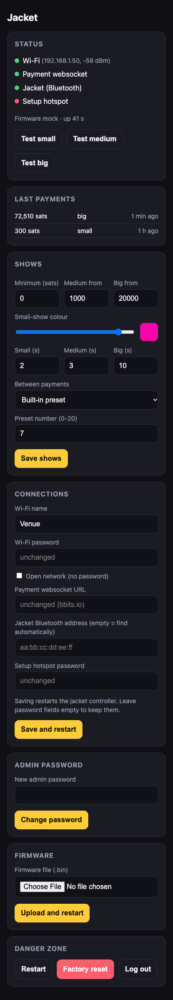

<!-- _class: title dark -->
<!-- _paginate: false -->

# The payment jacket

A store-bought LED jacket that puts on a light show every time someone pays us.

<!--
We wanted to turn something invisible, money arriving on a phone, into something everyone in the room can see.
-->

---

<!-- _class: dark -->

## Where we started

- An LED jacket with a small battery controller
- It only works with the maker's phone app
- Someone had to tap the app: nothing else could control it

<!--
The jacket could already do colours and effects. The problem: only a person with the app could make it do anything.
-->

---

<!-- _class: one -->

Step 1 of 5

## Learning the jacket's language

- The controller listens over Bluetooth, like wireless headphones
- Hobbyists had already written down the commands it understands
- Our first test: "lights off", then "lights on", and it worked

<!--
It's like finding a phrasebook. Once we knew the phrases for "turn off" and "turn red", we didn't need the official app any more.
-->

---

Step 2 of 5

## Making our own light shows

- Single colours, smooth rainbows, a fast disco strobe
- Lots of tweaking: too slow is boring, too fast just flickers
- One limit: the whole jacket shows one colour at a time

<!--
We tried every built-in effect and our own, and tuned the timing until it looked good on the jacket.
-->

---

<!-- _class: one -->

Step 3 of 5

## Listening for payments

- Our wallet sends a live message for every payment
- The message says how much was paid
- Our program listens around the clock, like waiting for a doorbell

<!--
The wallet rings the bell on every payment, and our program is always listening for it.
-->

---

Step 4 of 5

## Connecting the two

Payment arrives<b>→</b>Program hears it<b>→</b>Jacket lights up

- About one second from payment to light
- Tested with dozens of real payments, and the jacket responded every time

<!--
This was the moment it all came together: a payment from a phone, and the jacket lit up straight away.
-->

---

## Bigger payments, bigger show

| | | |
|---|---|---|
| <i></i><i></i><i></i> | **Under 1,000 sats** | A soft yellow glow, 2 seconds |
| <i style="color:#FFC93C"></i><i style="color:#FF5FA2"></i><i style="color:#3DD6B0"></i> | **1,000 – 9,999 sats** | A disco rainbow, 3 seconds |
| <i style="color:#FFFFFF"></i><i style="color:#9B8CFF"></i><i style="color:#FFFFFF"></i> | **10,000 sats and up** | The full light show, 10 seconds |

The jacket stays dark in between. All of this can be changed from a phone.

<!--
Bigger payments should feel special. The big show builds up like fireworks: rainbow, then strobe, then white flashes. Right now we've set it to a disco for every payment, chosen on the phone.
-->

---

<!-- _class: one -->

Step 5 of 5

## Leaving the laptop at home

- At first a laptop had to be nearby to run everything
- Now a matchbox-sized board does it all, for a few euros
- It joins Wi-Fi, listens for payments and drives the jacket by itself

<!--
The laptop proved the idea. The small board makes it something you can wear anywhere.
-->

---

## Set up from your phone

- The board opens its own Wi-Fi: "Jacket-Setup"
- Join it and a settings page appears, like hotel Wi-Fi
- Pick the Wi-Fi, wallet, colours and show lengths, then press "Test"
- Password-protected, so only we can change it

<!--
No programmer needed. Everything happens on a simple page on your phone.
-->

---

## Anyone can build one

- The software and instructions are public online
- Putting the software on a new board takes one command
- Updates install over Wi-Fi: no cables needed

<!--
Anyone with the same jacket and a few euros for the board can copy what we did.
-->

---

<!-- _class: yellow -->

## What we learned

- Test the smallest thing first: just on and off
- Reuse what others have already discovered
- Make it work on a laptop, then make it portable
- Make setup easy enough for anyone

---

<!-- _class: white -->

## Where it stands

- **Working:** the jacket reacts live to real payments
- **Running:** the stand-alone board, set up entirely from a phone
- **Next:** wearing it at a real event

<!--
The laptop version handled dozens of real payments, and the stand-alone board is now running on our Wi-Fi. Next we wear it live.
-->

---

<!-- _class: title -->
<!-- _paginate: false -->

# Pay us. Watch us glow.

An LED jacket that listens for payments and puts on a light show for each one.

